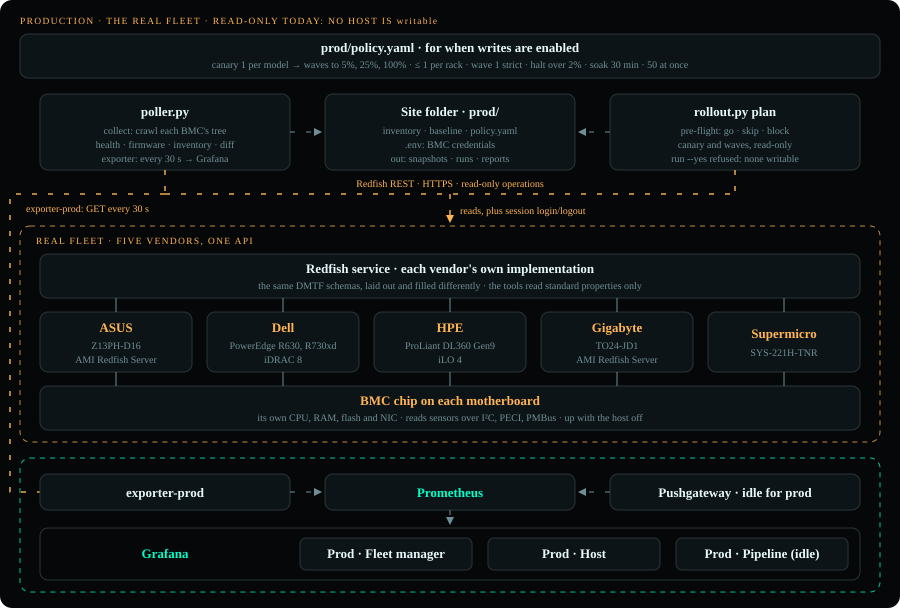
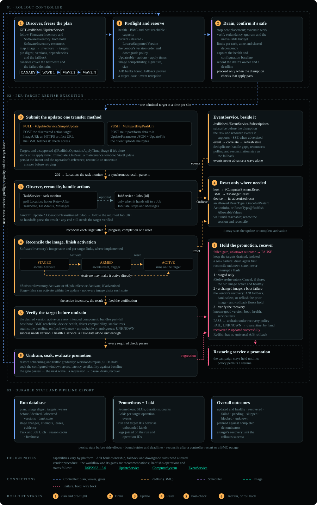

# Production

The real fleet, ASUS, Dell, HPE, Gigabyte and Supermicro, has only been read: collects, plans, dry runs and the
exporter, never an update. This page covers how a production rollout is built and run, the exporter on the real
fleet, the update as Redfish resources, the fleet in Grafana, what isn't built yet, and the system the rollout grows
into at fleet scale, with how this repository maps onto it. Every update so far ran on [the lab](LAB.md), which also
has [the rollout step by step](LAB.md#how-the-rollout-works).

## Current production setup



`SITE=prod` selects the real fleet's inventory, credentials and policy. The current setup uses the read-only
commands; the six-step update flow has been exercised only on the lab's BMCs.

Production (**ASUS**, **Dell**, **HPE**, **Gigabyte**, **Supermicro**) has been used **read-only**: `make collect SITE=prod`, the views (`make health SITE=prod`, `make firmware SITE=prod`...), `make plan SITE=prod`, `make dry-run SITE=prod`, and the prod site's exporter (`make site-up SITE=prod`), configured with a 30-second polling interval. They read only, plus a Redfish session login and logout. `make update` and `make fault` refuse `SITE=prod`, and no production host is tagged `writable`. The runner underneath can write: `rollout.py run --plan … --yes` updates a host tagged `writable` in NetBox, which is how a change window would run ([Before enabling production writes](#before-enabling-production-writes)). The Supermicro has no row in `prod/baseline.yaml` yet, so the plan skips it as not in the baseline.

The real fleet's hosts are NetBox's site `prod`, read as the lab's are ([NetBox](LAB.md#netbox-the-inventorys-source-of-truth)).
A host is added in NetBox: a device of site `prod`, its manufacturer the vendor and its tenant the project (its rack
when known); its management-only interface `bmc` with the BMC's address, set as the device's out-of-band IP; and its
platform, the vendor's BMC (`DELL BMC`, `HPE BMC`...), whose config context names the BMC account's env vars:

```json
{"username_env": "DELL_REDFISH_USERNAME", "password_env": "DELL_REDFISH_PASSWORD"}
```

```sh
# prod/.env, read by make: the account's values
DELL_REDFISH_USERNAME=...
DELL_REDFISH_PASSWORD=...
```

The proposed production rollout, from the whole fleet down to one host (rings and scheduler integration are not
implemented here):

1. **Rings, one at a time.** The lab's emulated BMCs first, then internal or spare nodes, then production region by
   region. A bad image that reaches every region at once can't be contained; the same pipeline runs at each ring.
2. **One component per pipeline**, in rollout order: the BMC first (it carries the other updates), then BIOS, then the
   rest. The baseline says the target per hardware model, and the catalog has the image for each.
3. **Group by what fails together.** The canary covers every hardware model the update touches, because firmware
   faults follow the model. Each wave spreads across racks, with at most `max_per_rack` hosts of one rack in a wave,
   which limits concurrent disruption by host count, not measured spare capacity. The canary prefers this limit but
   can exceed it when a model has no candidate in another rack; PDUs, InfiniBand pods and capacity need additional
   admission checks, which are not built.
   Idle and spare nodes go first; the scheduler drains busy ones before a reset that restarts the host.
4. **Waves that grow, gates that start strict**, as [the rollout](LAB.md#how-the-rollout-works) does everywhere, with
   production's policy: canary, then 5%, 25% and the rest; the first wave strict, later ones halting over 2%; 30
   minutes of soak between waves.
5. **Evidence.** The plan, the run records and the report in `prod/runs/` are the change's record: `report.json` for
   the services that track fleet state, the report for the people who approve the next ring.

### Before enabling production writes

- **Accounts**: keep the poller on a ReadOnly role. Give the rollout its own account whose role can update firmware
  and perform the required reset; verify the privileges on each BMC. NetBox's `writable` tag is an
  application gate, not proof of the account's Redfish role.
- **Scope**: tag hosts `writable` in NetBox only for the change window, give each its rack, and tag a few
  representative spare hosts per model `canary`. Who may edit NetBox decides who can open a change window.
- **Scheduler hooks**: `drain` and `undrain` are not configured in `prod/policy.yaml`, and no integration with a real
  scheduler has been validated here. Before a host-reset update, supply and test commands using `{node}`; the drain
  must return only after the node is empty, its jobs ended. Without a drain, pre-flight blocks updates whose reset
  restarts the host (BIOS, system firmware); a BMC-only reset needs none.
- **Images**: the vendor packages in `prod/images.yaml` with their sha256, and the packages of the versions running
  now, so every host has a way back. Serve them from the site's HTTPS cache and set `IMAGE_CACHE` to its address, as
  the lab does: `images.yaml`'s files become paths in it, and the rollout fetches, checks and pushes each one. A BMC
  that offers `SimpleUpdate` with the URL's protocol and target allowed can pull instead, given the image's full URL.
  The plan's Push and Pull columns show which, per resource, and pre-flight blocks a host whose method the BMC
  doesn't allow.
- **Run**: `make dry-run SITE=prod` makes no firmware changes; it still saves the plan and stage HTML files and can
  send the plan and its pre-flight checks to Loki when `LOKI` is set. The update itself, once hosts are tagged `writable`, is
  `SITE=prod YES=1 ./pipeline.sh "Manager (BMC)"` with `prod/.env` exported and `NETBOX_TOKEN` set to the rollout's
  token, from an admin host: the Makefile never writes
  to production. It needs `STATE_DB`, the state database where each stage locks its hosts; every admin host that
  runs a rollout must use the same one. The plan is the approval: its stages refuse to run when an input file changed since, and block a host
  whose BMC isn't the one the plan read. Set `ROLLOUT_ACTOR` to the person or system that authorized the run: on a
  shared admin host the account alone doesn't name a person, and the record should.

## The exporter on the real fleet

Judge host health from the `ComputerSystem` resource's `Status.HealthRollup` (or `Status.Health`) and inspect its
`Status.State`, alongside the Manager's own status. An HTTP 200 from `/redfish/v1` only confirms service availability.
The rollout already checks health on both discovered resource types before an update and compares it afterward.
The BMC and its Redfish service must be reachable to read the System resource; the host can be off or unhealthy
while its BMC continues to answer. See [availability and resource health](LAB.md#availability-and-resource-health).

What the exporter does differently from a one-off `collect`, because it never stops:

- **One Redfish session per BMC, reused while valid.** A login per read adds entries to the BMC's own logs. The
  exporter logs out after a read when the reported `SessionService.SessionTimeout` is shorter than the configured
  polling interval. At the current 30-second interval, a timeout of exactly 30 seconds does not meet that condition;
  a session that expires gets a new login when the next read returns 401. On shutdown it logs out of held sessions.
- **A refused login stops that host.** A 401 on a fresh login is not retried until a restart, since BMCs lock the
  account after a few failures; `redfish_login_refused` says so.
- **Prod targets a read every 30 seconds.** [The site's Compose](site/docker-compose.yaml), started by
  `make site-up SITE=prod`, sets `--interval 30`; the site's Prometheus agent scrapes the exporter every 10 seconds and
  pushes each sample to Prometheus (remote write), so the control plane never connects into the site. Each BMC has its own loop: if a crawl takes longer than the
  interval, the next starts immediately after it. The crawl budget is three intervals (90 seconds here), or a
  shorter inventory deadline, checked between requests. A full iDRAC 8 crawl previously took about two minutes, so
  this setting can produce partial reads and leave little idle time. Reassess the interval against complete crawl
  times before expanding the fleet. A scrape serves the latest finished read; it does not trigger a new crawl.
- **Units and thresholds from the standards.** A reading's unit comes from the BMC's `MetricDefinition`, else the
  DMTF schema of its resource (`ReadingCelsius` is `Cel`), else its `ReadingUnits`, else the unit DMTF's newest Sensor
  schema gives its `ReadingType` (a Gigabyte's v1.0 Sensors report none). Thresholds take the Sensor schema's names
  (`UpperThresholdNonCritical` in Thermal is `UpperCaution`); a 0 is none set (iLO 4, and AMI's lower thresholds).
- **No task queue.** Prometheus schedules the scrapes and the exporter its reads. Celery would add a broker, workers
  and a beat scheduler for one periodic read; durable, resumable jobs, like a rollout, belong to the workflow engine
  of [a production system](#a-production-system---scaling-for-a-large-fleet).

### Future work: BMC events into Loki

Today the events in Loki come from `rollout.py`, as [the lab's event flow](LAB.md#how-the-lab-sends-events-to-loki)
describes. Receiving hardware alerts independently of a rollout needs a separate event receiver; this integration
has not been implemented or tested on the production fleet.

1. Discover each BMC's `EventService` and the delivery methods it supports. For HTTP event delivery, create an
   `EventDestination` subscription in its `Subscriptions` collection, with the receiver's HTTPS URL as `Destination`.
   Creating a subscription writes BMC configuration; it is outside the current read-only production setup.
2. The BMC posts an `Event` payload to the receiver. Preserve its `Events` entries and available fields such as
   `MessageId`, `Severity`, `EventTimestamp` and `OriginOfCondition`, together with the source BMC.
3. The receiver converts those events into Loki log entries and sends them to `POST /loki/api/v1/push`. Loki itself
   does not create Redfish subscriptions or receive Redfish payloads directly in this design.
4. Validate delivery on each model, monitor the receiver and subscription state, and handle retries and duplicate
   deliveries. Keep the exporter polling: event delivery complements the current health readings.

The proposed flow is `BMC EventService → event receiver → Loki → Grafana`. DMTF's
[event delivery specification](https://www.dmtf.org/sites/default/files/standards/documents/DSP0266_1.17.1.html#eventing)
defines subscriptions and notifications; its [Redfish Event Listener](https://github.com/DMTF/Redfish-Event-Listener)
is a starting point for evaluating a receiver.

## The update, resource by resource

The diagram is the target production design, including capability-dependent flows that the current runner does
not implement. It is not evidence of production updates; [Not built yet](#not-built-yet) lists the gaps.



## The production fleet in Grafana

The Prod folder over two days of the real fleet, read-only. The fleet manager shows which BMCs answer, their health,
equipment and firmware, and how each component can be updated; the host dashboard shows one host in full: its
firmware, the health of every component, and every reading against its thresholds. Its Hosts table is grouped by
project: a row per project with its hosts' count and the worst Redfish and health among them, open for its hosts.

### Fleet manager


### Host


## Not built yet

- **Production activation validation**: the runner requests `OnReset`; it does not negotiate apply times or drive a
  Task-to-Job handoff. Validate the supported apply time, reset and recovery procedure per model before enabling
  writes. Only the lab's OpenBMC update path has been exercised end to end.
- **Complete promotion checks**: blocked/skipped hosts are excluded from the failure-rate denominator, so a passed
  gate does not prove every planned host updated. A soak failure halts but does not drain again or roll back;
  workload health and capacity checks need a real scheduler and host integration.
- **Other update flows**: switching to the other A/B bank as a rollback (pre-flight doesn't count a bank as a way
  back), an `Activate` action, a staged image, an apply scheduled as a Job. The rollout uses an upload applied at
  reset, its own reset, and a reinstall of the version before as the way back.
- **Durable orchestration**: picking up a stopped run where it was, after a crash; resolving a request whose answer
  was lost (an update the BMC may or may not have taken). The state database holds a lock per host and each host's
  latest step, and the run records every step, but nothing resumes from them: a stopped run keeps its hosts' locks, a
  person checks and unlocks them, and the pipeline is planned and run again; pre-flight skips the hosts already on the
  target. In production this is the workflow engine and the rollout state
  database ([a production system](#a-production-system---scaling-for-a-large-fleet)).
- **Limits beyond racks**: per PDU, fabric pod or remaining capacity.
- **Pull integrity**: a pulled image is never seen by the agent, so its sha256 isn't checked against the catalog;
  it requires a trusted image URL, enforced store immutability and a validated BMC signature check. The lab store
  does not enforce immutability, and the lab BMCs do not support pull.
- Rolling out ring by ring or region by region.
- **A rollout API**: an operator starts and approves a rollout only from the CLI (`make`, `YES=1`).
- **BMC events into Loki**: an event receiver, Redfish subscriptions and forwarding of `Event` payloads, validated
  per model; see [the proposed event flow](#future-work-bmc-events-into-loki).

## A production system - scaling for a large fleet


The target at fleet scale, in four parts. The numbered badges are the rollout's steps where they happen: 0 is ingest,
before any rollout; 1 to 6 are every host's steps, as in [the rollout](LAB.md#how-the-rollout-works). The BMC stays the
only truth about what runs: a host is read again over Redfish before anything acts on it.

### Supply chain: before any rollout

| Part | Tool | What it does |
|---|---|---|
| Ingest | a promote script, as `control/ingest/promote-fw-images.sh` | downloads the vendor package, checks its checksum and its signature against the vendor's pinned key |
| Lab test | lab hosts of every model | runs the image on each model before it is approved |
| Approved store | S3 or Artifactory | keeps each approved image under its sha256; the storage policy prevents replacing one |

### Control plane

| Part | Tool | What it does |
|---|---|---|
| Rollout API and CLI | a service in front of the engine | an operator requests a rollout and approves the canary |
| Inventory / CMDB | **NetBox** or Nautobot | the devices: each server with its rack, project and model, and its BMC's out-of-band address |
| Firmware catalog and baseline | **YAML in git**, never in NetBox | one per site: the approved version per model and component, and each version's image file and sha256; a merged pull request is the approval, not a database edit |
| Workflow engine | Temporal, or Argo Workflows | pre-flight, the canary and waves, the gates and the soak; continues after a crash |
| Engine store | the engine's own: PostgreSQL or Cassandra for Temporal | its workflow history, which it replays to continue |
| Rollout state DB | PostgreSQL | each host's state and wave, a lock per host, an append-only audit trail; a gate is a query |
| Secrets | Vault | the BMC credentials, per site; rotating them needs a separate, validated integration |

### Each site

| Part | Tool | What it does |
|---|---|---|
| Site agent | `rollout.py run` here | takes a wave's work, drains the hosts, drives the update over Redfish |
| Image cache | nginx over HTTPS | serves the store's images inside the site: a BMC that offers `SimpleUpdate` pulls from it, the agent pushes to one that can't |
| Scheduler | the site's own, as Slurm or Kubernetes | drains and undrains the hosts, through a validated integration |
| Exporter | `poller.py exporter`, on a ReadOnly account | reads every BMC's health, firmware and telemetry for Prometheus; never the agent |
| Prometheus agent | Prometheus in agent mode | scrapes the exporter and pushes each sample to the control plane's Prometheus (remote write): the site connects out, never in |
| Event receiver | a small HTTPS service, as DMTF's Redfish Event Listener | subscribes to each BMC's `EventService`, receives the events the BMCs post to it and forwards them to Loki ([not built yet](#future-work-bmc-events-into-loki)); the BMCs reach it inside the site, and it connects out |
| BMCs | each vendor's Redfish service | run the update, its task and the reset; their `EventService` posts their events to the event receiver |

### Observability

| Part | Tool | What it does |
|---|---|---|
| Metrics | Prometheus, fed by each site's Prometheus agent (remote write) | scrapes the workflow engine; takes each site's samples, the exporter's and the site agent's |
| Logs | Loki | the rollout's events; the BMCs' events through an event receiver ([future work](#future-work-bmc-events-into-loki)) |
| Dashboards | Grafana | reads Prometheus, Loki and the rollout state DB |
| Alerts | Alertmanager | pages the on-call on a halt or a host left for a person |

What each one holds:

| Store | What goes in | From | What it answers |
|---|---|---|---|
| Prometheus | numbers over time: every reading and threshold, each component's health, firmware versions, BMCs answering; a rollout's hosts per state, step durations and gates | the exporter, which polls the BMCs over Redfish, and the site agent, both through the site's Prometheus agent; the workflow engine, scraped | is the fleet healthy, what runs where, how far a rollout is |
| Loki | events as text: each step's intent and result, a Task's messages, every pre-flight check; the BMCs' own events | the site agents and the workflow engine; the event receiver | what happened to a host, and why |
| Rollout state DB | a lock per host; every event of every run, append-only | the workflow engine and the site agents, over SQL | who may touch a host now; the audit trail |

Prometheus doesn't subscribe to Redfish events: it pulls numbers on a schedule, while a BMC's `EventService` pushes
messages, so BMC events take the event receiver's path to Loki. The exporter's polling stays the source of truth for
state: an event a receiver misses is not sent again.

**No Pushgateway in production.** A Pushgateway holds the metrics of a job too short-lived to be scraped. In the lab,
`rollout.py run` is such a job, a command `make` starts and that exits, so it pushes to one. In production the rollout
runs in long-lived services that serve their own `/metrics`: the workflow engine, which Prometheus scrapes inside the
control plane, and each site agent, which the site's Prometheus agent scrapes and pushes, as it does the exporter. That
also avoids the Pushgateway's own limits: a single instance, no high availability, and each pipeline's last push kept,
looking current, until someone deletes it.

**How Prometheus scrapes the workflow engine.** As any service: a scrape job in the control plane's Prometheus, so the
scrape never leaves the control plane.

- **Temporal.** The server serves its own metrics (workflow and task-queue latency, backlog) on the address
  `global.metrics.prometheus.listenAddress` sets. The worker that runs the rollout's workflow and its activities serves
  the rollout's: waves, gates, hosts per state, step durations, counted with the SDK's metric meter and served from its
  Prometheus endpoint (in Python, `PrometheusConfig(bind_address=...)` in the runtime's telemetry). Prometheus scrapes
  both.
- **Argo Workflows.** Its workflow-controller serves `/metrics`, on port 9090 by default, and a Workflow declares its
  own metrics under `metrics.prometheus`: gauges, counters and histograms the controller emits. The controller is the
  only target.

```yaml
# the control plane's prometheus.yml, Temporal: the server and the rollout's worker (example addresses)
scrape_configs:
  - job_name: temporal-server
    static_configs: [{targets: ["temporal:8000"]}]
  - job_name: rollout-worker
    static_configs: [{targets: ["rollout-worker:9000"]}]
```

On Kubernetes the targets come from service discovery instead of a static list: a `ServiceMonitor` with the Prometheus
Operator, or `kubernetes_sd_configs`. The site agents' metrics still arrive by remote write, through each site's
Prometheus agent.

### Firmware images: the catalog says what, the cache holds the bytes

The firmware catalog lists, per hardware model and component, the approved version with its file and sha256 (today
`baseline.yaml` and `images.yaml`). In the target design an image gets in only after its checksum
and signature are checked and it has passed on lab hosts of that model;
it is then promoted into the approved store, and each site's HTTPS cache serves it from there. Pull and push both read
the catalog and both take the bytes from the site's cache, never from a vendor at update time; they differ in who
downloads:

| | Pull: `SimpleUpdate` | Push: `MultipartHttpPushUri` |
|---|---|---|
| Who downloads the image | the BMC, from the cache URL the site agent hands it | the site agent, from the same cache |
| Checked before it is flashed | its sha256 when it was promoted; the vendor's signature by the BMC. Nothing compares what the BMC downloads with the catalog | its sha256 by the agent, against the catalog, before it pushes; the signature by the BMC |
| What keeps it the approved image | a digest-addressed URL plus enforced immutability/write restrictions in the store; the path alone does not enforce it | the agent's check: a copy that doesn't match is deleted, never pushed |
| The path | cache → BMC | cache → agent → BMC |
| For | a BMC that allows the URL's protocol and target | a BMC that can't pull, like the lab's GB200 build |

The target design should prewarm and verify every required image, including rollback images, before the canary.
Today pre-flight fetches required push images on demand and verifies the local copies; it does not prewarm pull URLs.
The lab runs the push column for real ([The lab stack](LAB.md#the-lab-stack)).

There is one catalog per site, `control/catalog/<site>/`, as each fleet has its own models and approved versions. The
catalog and the caches meet on one key, the image's path. A catalog entry names its image by a path in the approved
store, preferably under its sha256 (`bmc/<sha256>.tar`), with storage policy preventing replacement; every site's cache
serves the store's files under the same paths, so a site's configuration holds only its cache's address. The current
runner joins `IMAGE_CACHE` with relative paths for push; pull entries must already contain the full cache URL.
Constructing a site's pull URLs from those paths is future work. Promotion writes the
file first and the catalog entry after it; cache and store availability must still be checked before execution.

### This repository today

| In the system | In this repository today | Next |
|---|---|---|
| Approved store, site cache | the control plane's store, a SeaweedFS bucket populated by the signature-checking ingest script, and the lab site's nginx over HTTPS caching it: `rollout.py` fetches each image into `lab/spool/`, checks its sha256 against `images.yaml` and pushes it. A URL in `images.yaml` is handed to `SimpleUpdate` where the BMC allows it | the approved store on S3 or Artifactory, and the same nginx cache in each site |
| Firmware catalog | `control/catalog/<site>/`: prod's `baseline.yaml` is tracked; the lab's baseline and images catalog are written by the ingest, git-ignored | stays YAML reviewed in git, beside NetBox, not in it: prod's `images.yaml` beside its baseline, and a check of every change (each baseline version in the catalog, each entry with its sha256, each file in the store); the plan keeps the entries it used in `plan.json`, and each stage compares them again |
| Inventory / CMDB | NetBox holds both sites' hosts, each BMC's account named in its platform's config context; each service reads it with its own read-only account. The poller's snapshots are the observed versions, and `make firmware SITE=prod` shows drift from the baseline | the exporter re-reading NetBox while it runs; people's accounts and roles in NetBox, through SSO; NetBox backed up |
| Rollout API and CLI | the CLI only: the `make` targets and `pipeline.sh`; `YES=1` is the approval. Who planned, started or cancelled a run is recorded (`ROLLOUT_ACTOR`, else the account and host), with the commit each catalog file was approved in | an API, and an approval between the canary and wave 1; `ROLLOUT_ACTOR` from what authorized the run, a CI's actor or the API's authenticated user |
| Workflow engine | `pipeline.sh`'s stages and `rollout.py run`: waves, gates, soak | a service that resumes a stopped rollout |
| Rollout state DB | PostgreSQL in the control plane ([control/state/schema.sql](control/state/schema.sql)): a lock per host, which a stage takes for all its hosts or none, and every event of every run, append-only to the rollout's account, kept until deleted; Grafana reads it with an account that may only read. `<site>/runs/*.jsonl` keeps every event on the agent's disk too, `report.json` the report. No resume | one database for every site's agents, the gate as a query, and a retention for events, which PostgreSQL lacks: daily partitions, dropped after the audit period |
| Engine store | none: a rerun plans again, and pre-flight skips the hosts already on the target | the engine's own |
| Site agent | `rollout.py run` on an admin host | one per site |
| Scheduler | Optional `drain` and `undrain` hooks; neither site configures them, and no integration with a real scheduler has been validated | implement and validate the site's commands, including waiting for the node to become empty |
| Secrets | `prod/.env`, and the control plane's `.netbox.env`, `.tokens.env`, `.state.env` and `.grafana.env`, git-ignored | Vault-backed storage; validate account rotation separately |
| Observability | the report: terminal, HTML and `report.json`; an exporter and a Prometheus agent per site, pushing every BMC's telemetry, health and firmware to the control plane, the rollout's metrics pushed live, its events in Loki, and Grafana dashboards in a folder per site ([Observability](LAB.md#observability)) | paging the on-call on a halt or a host left for a person; a Pushgateway in each site, read by its agent; an event receiver that subscribes to Redfish `EventService` and forwards BMC events to Loki |
